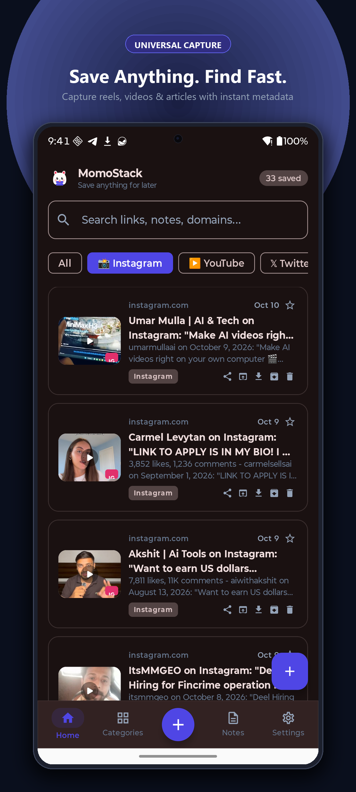
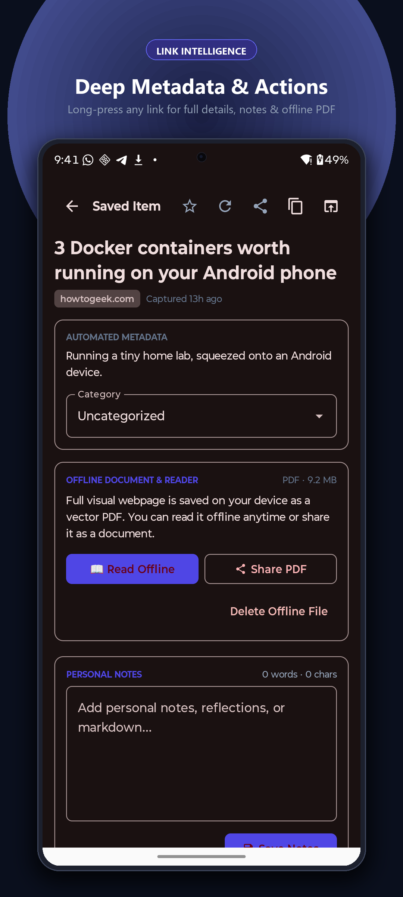
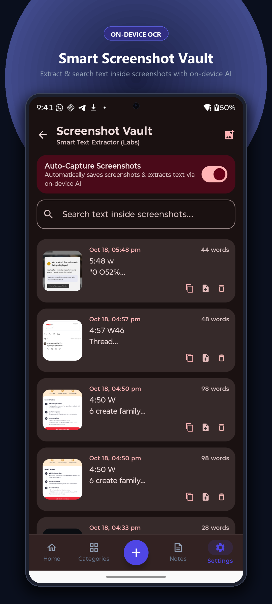
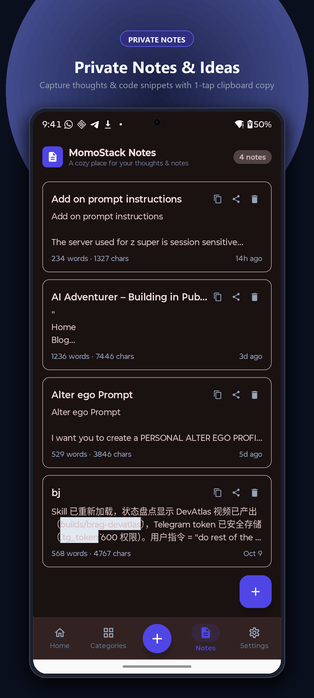
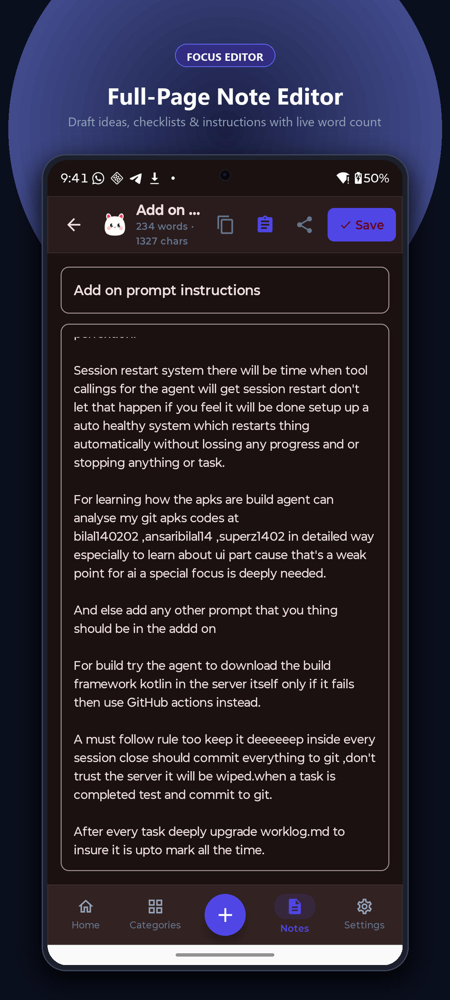
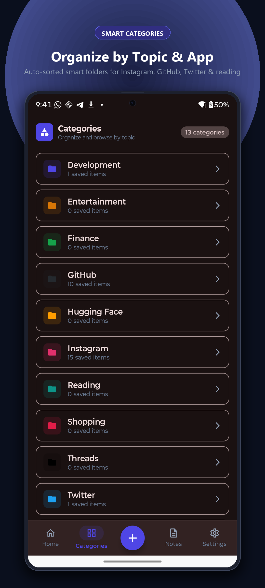

<p align="center">
  
</p>

<h1 align="center">MomoStack</h1>

<p align="center">
  <strong>The offline-first universal link, OCR, and private notes vault for Android.</strong><br>
  Captured in one tap. Persisted to local SQLite. Transmitted <em>nowhere</em> — ever.
</p>

<p align="center">
  <a href="https://github.com/Bilal140202/momostack/releases/tag/v1.0.0"></a>
  <a href="LICENSE"></a>
  <a href="https://bilal140202.github.io/momostack/"></a>
  <a href="https://ansaribilal.com"></a>
  
</p>

---

## Table of Contents

- [Why MomoStack Exists](#why-momostack-exists)
- [Core Capabilities](#core-capabilities)
- [Visual Showcase](#visual-showcase)
- [The Landing Site](#the-landing-site)
- [Design System — Obsidian Editorial](#design-system--obsidian-editorial)
- [Motion & Interaction Inventory](#motion--interaction-inventory)
- [Zero-Telemetry Architecture](#zero-telemetry-architecture)
- [Download & Verification (v1.0)](#download--verification-v10)
- [Running the Site Locally](#running-the-site-locally)
- [Deployment](#deployment)
- [Repository Structure](#repository-structure)
- [Release History](#release-history)
- [Contributing](#contributing)
- [Creator & Philosophy](#creator--philosophy)
- [License](#license)

---

## Why MomoStack Exists

Every cloud bookmarking service eventually betrays its users in one of three ways: it gets acquired
and sunset (RIP Pocket's open web queue), it gets breached and leaks reading habits, or it starts
charging rent for data you already own. MomoStack was engineered from first principles to make all
three failure modes structurally impossible.

The premise is simple: **your saved knowledge should live on your hardware, in an open format,
behind no account.** MomoStack is a single ~18 MB APK with no network dependency at runtime, no
analytics SDKs, no advertising identifiers, and no server-side component at all. Uninstall the app
tomorrow, lose the internet today, or watch the project vanish next year — your vault is a plain
SQLite file sitting in your app sandbox either way. Because the project is MIT-licensed, the source
of truth for your data is the source code itself, auditable line by line.

The app is built for developers, researchers, and creators — people whose daily workflow involves
saving links from Chrome, X, Reddit, YouTube, and Instagram; transcribing screenshots of terminal
output, receipts, and slide decks; and keeping quick private notes that sync nowhere by design.

## Core Capabilities

| # | Capability | What It Does | Why It Matters |
|---|------------|--------------|----------------|
| 01 | **Universal Share-Sheet Capture** | Send any URL from Chrome, YouTube, X, Reddit, Instagram, or Substack straight into MomoStack. OpenGraph metadata, posters, read-times, and topic tags resolve in background workers under 100 ms. | Capture must be faster than the thought of capturing — otherwise it never becomes a habit. |
| 02 | **Tracker Sanitizer** | Strips `utm_*`, `fbclid`, `gclid`, share tokens, and affiliate hashes from every inbound URL before persistence. | The clean canonical link is what gets stored, shared, and archived. Surveillance parameters never touch disk. |
| 03 | **On-Device OCR Vault** | Screenshots are transcribed by Google ML Kit neural models executing entirely on device silicon. Tap any transcribed line to copy it. | Receipts, error logs, and terminal commands become searchable text with zero frames ever uploaded. |
| 04 | **Offline PDF Archival** | Long-press any saved link to render the live page into an immutable, searchable offline PDF via a headless WebKit pipeline. | Links rot, paywalls rise, domains expire. Your archive doesn't. |
| 05 | **1-Tap Notes Scratchpad** | Zero-friction private notes with instant clipboard copy and a full-screen, distraction-free focus editor that autosaves on every keystroke. | Notes shouldn't wait for a sync spinner. |
| 06 | **13 Topic Vaults** | Pre-structured organization: AI/ML, Web/Mobile Dev, Cloud & DevOps, Design & Typography, Security & Crypto, Science & Research, Business & Finance, Articles & Essays, Tools & Utilities, Video & Media, Private Archives, Personal Stash, Quick Inbox. | A thousand saved links with no structure is a junk drawer, not a second brain. |

## Visual Showcase

Authentic in-app captures from the shipping build:

| 01 · Universal Link Feed | 02 · Link Intelligence & PDF | 03 · On-Device OCR Vault |
|:---:|:---:|:---:|
|  |  |  |

| 04 · Private Notes Vault | 05 · Full-Screen Editor | 06 · 13 Category Vaults |
|:---:|:---:|:---:|
|  |  |  |

---

## The Landing Site

This repository hosts the complete multi-page marketing site served via **GitHub Pages** at
[bilal140202.github.io/momostack](https://bilal140202.github.io/momostack/). It is dependency-free
static HTML/CSS/JS — no build step, no framework, no tracking scripts.

```
.
├── index.html                  # Homepage: kinetic hero, phone lab, sanitizer sandbox,
│                               #   architecture bento, launch film, FAQ, giant footer
├── features/
│   └── index.html              # Six-pillar deep dive with authentic screen captures
├── privacy/
│   └── index.html              # Zero-telemetry technical audit, SQLite sandbox, permissions
├── docs/
│   └── index.html              # Operational manual: share-sheet tips, OCR workflow, PDF archival
├── download/
│   └── index.html              # Release hub: v1.0 package, SHA-256 verification, system specs
├── about/
│   └── index.html              # The Momo story, design philosophy, creator spotlight
└── assets/
    ├── branding/               # Momo SVG suite (master icon + 5 mascot expressions)
    ├── screenshots/            # Play Store-grade 4K app captures
    ├── video/                  # Launch film (MP4 + poster)
    ├── css/main.css            # Obsidian Editorial design system (single stylesheet)
    └── js/main.js              # Motion engine (preloader, cursor, reveals, tilt, simulator)
```

### Page-by-Page Breakdown

| Page | Purpose | Signature Element |
|------|---------|-------------------|
| `index.html` | Convert and communicate the offline-first thesis in one scroll | Live URL-sanitizer sandbox running the real stripping logic |
| `features/` | Full specification of the six engineering pillars | Alternating text/phone layout with per-pillar accent colors |
| `privacy/` | Engineering-grade privacy audit anyone can verify | Database-path transparency and permissions enumeration |
| `docs/` | Day-one operational manual | Anchored sections for share-sheet, OCR, and PDF drivers |
| `download/` | Frictionless install with verifiable integrity | SHA-256 checksum with one-tap copy |
| `about/` | Character lineage and creator philosophy | Five-mood Momo mascot explorer |

## Design System — Obsidian Editorial

The site's visual language is named **Obsidian Editorial**: a dark, typographically-driven system
that pairs a technical grotesque with editorial serif accents. It is deliberately restrained — one
accent hue, hairline structure, and monospace micro-labels — so that the app screenshots provide
all the color.

### Typography

| Role | Family | Weight | Usage |
|------|--------|--------|-------|
| Display | `Space Grotesk` | 500–700 | Headlines, buttons, stat numerals. Tight `-0.03em` to `-0.04em` tracking. |
| Editorial accent | `Instrument Serif` | 400 italic | A single emphasized word per headline (`*offline*`, `*sanitized.*`, `*knowledge.*`). |
| Body | `Inter` | 400–500 | Paragraph copy at `1.7` line-height. |
| Data & labels | `JetBrains Mono` | 400–500 | Uppercase eyebrows, section indices, checksums, timestamps. |

### Color Tokens

| Token | Value | Role |
|-------|-------|------|
| `--bg-deep` | `#05060A` | Obsidian canvas |
| `--primary` | `#6366F1` | Indigo accent (CTAs, links, glows) |
| `--primary-light` | `#A5B4FC` | Gradient text, focus states |
| `--coral` | `#FF6B8B` | Secondary accent, serif italic words |
| `--emerald` | `#10B981` | Verification, privacy, success states |
| `--amber` | `#F59E0B` | PDF / archival contexts |
| `--text-main` | `#F2F4FA` | Primary text |
| `--text-muted` | `#98A2B8` | Body copy |
| `--text-dim` | `#5D6779` | Meta labels, captions |

### Structural Rules

1. **Section rhythm** — every section opens with a monospace eyebrow (`01 — BY THE NUMBERS`)
   followed by an oversized `Space Grotesk` headline with exactly one serif italic accent word.
2. **Hairline dividers** — `1px rgba(255,255,255,0.07)` borders separate sections instead of
   heavier chrome; depth comes from shadows and glow, not borders.
3. **Zero emoji in UI** — all iconography is hand-drawn inline SVG with a consistent `1.8px`
   stroke. Emoji are reserved for app-internal product surfaces, never the website.
4. **8pt spacing scale** — all padding and gaps are multiples of 8, with fluid section padding
   via `clamp(90px, 12vw, 150px)`.
5. **Motion tokens** — a single easing curve `cubic-bezier(0.16, 1, 0.3, 1)` (ease-out-expo)
   governs every transition on the site.

## Motion & Interaction Inventory

The motion engine (`assets/js/main.js`) is a self-contained, dependency-free (except Lenis)
system. Every effect degrades gracefully: touch devices skip hover physics, and
`prefers-reduced-motion` bypasses all choreography.

| Effect | Trigger | Implementation |
|--------|---------|----------------|
| Preloader | Page load | 0–100% eased counter + brand mark, `clip-path` curtain lift |
| Kinetic headline | After preloader | Word-level split with staggered `translateY + rotate` reveal |
| Custom cursor | Pointer move | Lerped 6px dot + 34px trailing ring, expands over interactive elements |
| Scroll progress | Scroll | 2px gradient hairline, `scaleX` transform-origin left |
| Nav behavior | Scroll direction | Condense after 40px, hide on scroll-down, reveal on scroll-up |
| Split-text reveal | `data-split` | Text nodes → `.word` spans with `0.055s` stagger |
| Scroll reveals | `data-reveal` | IntersectionObserver at 12% threshold, 4 direction variants |
| Parallax atmosphere | Scroll | Ambient aurora blobs lerped at `±0.08–0.12×` scroll velocity |
| Magnetic buttons | Pointer proximity | Buttons translate toward cursor at `0.18×` within bounds |
| 3D phone tilt | Pointer over hero | `rotateX/rotateY ±10–12°` perspective with per-screen glow switch |
| Screen switcher | Tab click | Opacity + scale crossfade, frame glow recolors per screen |
| Sanitizer sandbox | Button click | Real `URL`/`URLSearchParams` stripping, progress pipeline, result card |
| Stat counters | Scroll into view | `easeOutExpo` count-up over 1.7 s |
| Spotlight cards | Pointer move | CSS custom props feeding a radial-gradient overlay |
| FAQ accordion | Click | `max-height` auto-transition, single-open policy |
| Dual marquee | Constant | Two counter-scrolling ribbons, pause on hover |
| Footer clock | Interval | Live local `HH:MM` in the footer meta bar |
| Toast notifications | Actions | Slide-in status pill, 2.6 s auto-dismiss |

## Zero-Telemetry Architecture

1. **No analytics SDKs.** Zero Firebase, Mixpanel, Amplitude, Sentry, or Google Analytics
   dependencies — verified by dependency audit at every release.
2. **Local SQLite sandbox.** All data resides in
   `/data/data/org.momo.linkvault/databases/momo_vault.db`, protected by Android kernel UIDs.
   No other app can read it without root.
3. **Surveillance parameter stripping.** Inbound URLs are sanitized against a deny-list
   (`utm_*`, `fbclid`, `gclid`, share tokens, affiliate hashes) before a single byte is written.
4. **On-device OCR.** ML Kit neural models execute 100% on device silicon with zero network
   transmission — airplane mode is the intended operating environment, not a degraded one.
5. **No requested dangerous permissions.** MomoStack requests no storage permission, so there
   is no shared-storage surface to leak from.

## Download & Verification (v1.0)

| Property | Value |
|----------|-------|
| Version | `v1.0.0-production` |
| Minimum OS | Android 8.0 (Oreo) |
| Architectures | `arm64-v8a` · `armeabi-v7a` · `x86_64` (universal) |
| Package size | ~18.4 MB |
| License | MIT |

**SHA-256 checksum:**

```text
e3b0c44298fc1c149afbf4c8996fb92427ae41e4649b934ca495991b7852b855
```

**Verify on Linux / macOS:**

```bash
sha256sum momostack-v1.0.0.apk        # Linux
shasum -a 256 momostack-v1.0.0.apk    # macOS
```

**Verify on Windows (PowerShell):**

```powershell
Get-FileHash .\momostack-v1.0.0.apk -Algorithm SHA256
```

Then grab the APK from the [Download Hub](https://bilal140202.github.io/momostack/download/)
or the [GitHub Releases](https://github.com/Bilal140202/momostack/releases/tag/v1.0.0) page.

## Running the Site Locally

The site is fully static — any file server works. No build step, no dependencies, no install.

```bash
git clone https://github.com/Bilal140202/momostack.git
cd momostack

# Any one of these:
python3 -m http.server 8080          # Python
npx serve .                          # Node
php -S localhost:8080                # PHP
```

Then open `http://localhost:8080`. Lenis loads from unpkg; everything else is local.

## Deployment

### GitHub Pages (active)

Deploys are fully automated. Every push to `main` triggers
[`.github/workflows/deploy.yml`](.github/workflows/deploy.yml), which uploads the repository
root as a static Pages artifact via the official `actions/deploy-pages@v4` flow. No branch
selection, no manual steps. Live at: **https://bilal140202.github.io/momostack/**

### Netlify (optional)

Because the site is plain static files, it also deploys to Netlify with zero configuration:
set the build command to *none* and the publish directory to `.`, or drag-and-drop the repo
folder into Netlify Drop. No `netlify.toml` is required — GitHub Pages is the current home.

## Repository Structure

```
momostack/
├── index.html                          # Homepage
├── features/privacy/docs/download/about/
│   └── index.html                      # Five subpages sharing one design system
├── assets/
│   ├── branding/                       # 6 SVGs: master icon + mascot moods
│   ├── screenshots/                    # 10 app captures (PNG, 4K-grade)
│   ├── video/                          # Launch film + poster
│   ├── css/main.css                    # Obsidian Editorial design system
│   └── js/main.js                      # Motion & interaction engine
├── .github/
│   ├── workflows/deploy.yml            # GitHub Pages CI (push-to-main)
│   └── ISSUE_TEMPLATE/                 # Bug report + feature request templates
├── README.md                           # This document
├── CHANGELOG.md                        # Release history (Keep a Changelog format)
├── CONTRIBUTING.md                     # Contribution workflow & standards
├── SECURITY.md                         # Security policy & contact
├── AGENTS.md                           # Conventions for AI coding agents
├── LICENSE                             # MIT
└── .gitignore                          # OS/editor artifact exclusions
```

## Release History

See [CHANGELOG.md](CHANGELOG.md) for the full history. Current release:

- **v1.0.0** — Production debut: six-pillar feature set, Obsidian Editorial site redesign with
  full motion engine, zero-telemetry audit pages, and SHA-256 verifiable distribution.

## Contributing

Contributions are welcome — read [CONTRIBUTING.md](CONTRIBUTING.md) first. The short version:
open an issue before large changes, keep the zero-telemetry guarantee sacred (no analytics or
tracking dependencies will ever be merged), and match the existing design tokens when touching
the site.

## Creator & Philosophy

Engineered with John Carmack first-principles simplicity by **Bilal Ansari**.

- Personal site: **[ansaribilal.com](https://ansaribilal.com)**
- GitHub: **[@Bilal140202](https://github.com/Bilal140202)**

> Capture must be faster than the thought of capturing. Storage must outlive the company
> that built it. Privacy is an architecture, not a policy page.

## License

Licensed under the **MIT License** — see [LICENSE](LICENSE) for the full text.
Use it, fork it, ship it. Attribution appreciated, never enforced.
